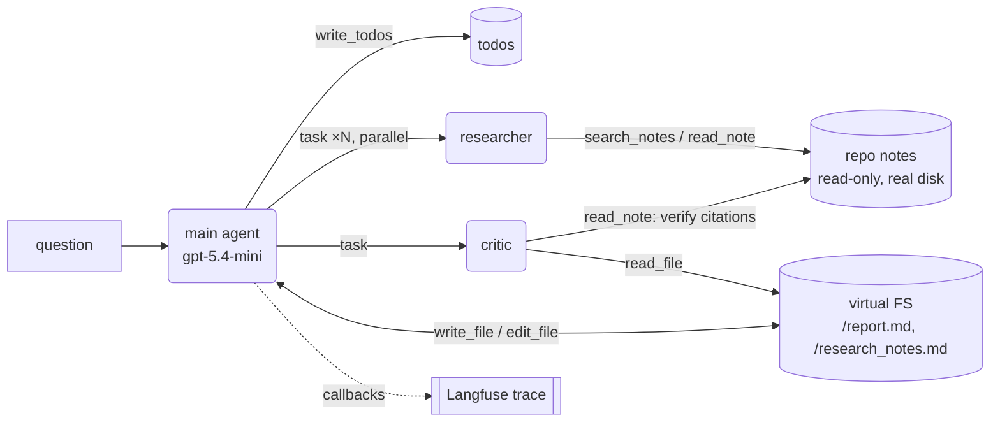

# Deep Research Agent (deepagents + LangGraph + Langfuse, OpenAI)

A **deep agent** that writes cited study guides from *this repo's own notes*. It plans, splits
the question into subtopics, sends parallel researcher subagents into the notes, drafts a report
in a virtual filesystem, has a critic subagent review it, and applies the fixes. Every step is
traced to **Langfuse**.

## Deep agent vs. the other agents in this folder

[`../k8s_oncall_agent`](../k8s_oncall_agent) and [`../langgraph_ollama_agent`](../langgraph_ollama_agent)
are *shallow* ReAct loops: one context window, call tools, answer. That breaks down on long tasks,
because the context fills with tool output and the model loses the plot. `deepagents`'
`create_deep_agent` builds a LangGraph graph with four additions:

| Ingredient | What it is here | Lives in |
|---|---|---|
| **Planning** | `write_todos` tool: a checklist the agent updates as it goes | graph state `todos` |
| **Virtual filesystem** | `ls`/`read_file`/`write_file`/`edit_file`/`glob`/`grep` | graph state `files` (never touches disk) |
| **Subagents** | `task` tool: runs a subagent in a **fresh context** and returns only its final answer | separate subgraph |
| **Long system prompt** | teaches the model to use all of the above | `deepagents` + `MAIN_PROMPT` |



Subagents share the virtual filesystem with the main agent, but not its messages or todos. That's
how the critic reads `/report.md` without the draft being pasted into its prompt.

| File | Role |
|---|---|
| `config.py` | Settings from `.env`: OpenAI model(s), notes root, Langfuse on/off |
| `llm.py` | `ChatOpenAI` factory, so main agent and subagents can use different models |
| `tools.py` | `search_notes` (keyword search) and `read_note`: **read-only**, can't escape `NOTES_ROOT` |
| `graph.py` | `create_deep_agent(...)` with `researcher` + `critic` subagents and the prompts |
| `agent.py` | CLI: streams main + subagent steps, wraps the run in a Langfuse trace, saves the virtual FS to `output/` |

## Setup

```bash
make install            # venv + deps, creates .env from .env.example
# edit .env: OPENAI_API_KEY (Langfuse keys optional: without them it runs untraced)
make run                # default question, or:
make run Q="How do I scope IAM for EKS node groups?" THREAD=eks-study
```

Results land in `output/report.md` and `output/research_notes.md`.

### Langfuse

Pick one:

- **Self-hosted (free, local):** `make langfuse-up` clones the official repo and runs its
  docker-compose (web, worker, Postgres, ClickHouse, Redis, MinIO; give Docker ~4 GB). Open
  http://localhost:3000, sign up, create a project, and copy its public/secret keys into `.env`
  with `LANGFUSE_BASE_URL=http://localhost:3000`. Run `make langfuse-down` to stop.
- **Cloud:** create a project at cloud.langfuse.com and set `LANGFUSE_BASE_URL` to its region.

How it's wired (`agent.py`, Langfuse Python SDK v5, which is built on OpenTelemetry):

```python
langfuse = get_client()
with langfuse.start_as_current_observation(as_type="agent", name="deep-research", input=...) as root, \
     propagate_attributes(session_id=thread_id, tags=["deep-agent", model]):
    agent.stream(..., config={"callbacks": [CallbackHandler()]})   # nests every LLM/tool/subagent span
    root.update(output=...)
langfuse.flush()   # spans export in the background, so flush before the process exits
```

In SDK v5, `session_id`/`tags` go through `propagate_attributes`, not the `CallbackHandler`.

## What a run looks like (observed)

```
main | -> write_todos(...)
main |   [ ] Research FastAPI disconnect behavior ...   [ ] Write /report.md ...   [ ] Have critic review ...
main | -> task[researcher]: Research ... what happens to backend work when a client disconnects ...
main | -> task[researcher]: Research ... how FastAPI runs under the hood ...        ← parallel
  sub | -> search_notes({'query': 'FastAPI client disconnect background work cancelled ...'})
  sub | -> read_note({'path': 'fastapi_practice/client_disconnect_lab/README.md', ...})
main | -> write_file(/research_notes.md)   -> write_file(/report.md)
main | -> task[critic]: Review /report.md against the original question ...
  sub | -> read_note(...)                  ← critic verifying citations against real notes
main | -> edit_file(...) ×4                ← applies critic's fixes
main |   [x] ... all 5 todos completed
saved output/report.md
```

About 70s and ~13-25 LLM calls per run with `gpt-5.4-mini`.

**Langfuse trace structure:** verified with an in-memory OTel exporter on a short run. Result:
**77 spans in 1 trace**, root `deep-research` (type agent), 13 `generation` spans (all LLM calls,
subagents included), 20 `tool` spans, 39 `chain` spans, session id and tags on the trace. A live
Langfuse UI hasn't been tested from this folder yet.

## Things this project's own runs caught

1. **`write_todos` is opt-in in deepagents 0.7.** It's not in the default tool set (only some
   model "harness profiles" add it). Without it, the model wrote its plan into `/tmp/todos.json`
   with `write_file`. Fixed with `middleware=[TodoListMiddleware()]` in `graph.py`.
2. **The critic needs access to the real sources.** With only the virtual FS, it grepped for the
   cited repo paths, found nothing, and wrongly flagged correct claims as unsupported. Giving it
   `read_note` lets it verify citations.
3. **`get_trace_url()` makes an API call.** If Langfuse is down, it raised *after* the agent had
   finished. It's now wrapped so tracing problems never fail a run.
4. **GPT-5-family models reject custom `temperature`**, so `llm.py` doesn't set one.
5. The built-in `execute` (shell) tool is registered but returns an error on the default in-memory
   backend. It only works on a sandbox backend, so this agent can't run commands.
